<!-- Hazel's GitHub profile: artwork authored in assets/ and generated by scripts/build_art.py -->
<picture>
  <source media="(prefers-color-scheme: dark)" srcset="./assets/header-dark.svg">
  <source media="(prefers-color-scheme: light)" srcset="./assets/header-light.svg">
  
</picture>

  <a href="https://hazeliscoding.dev">Portfolio</a> ·
  <a href="https://www.hazeliscoding.dev/blog/every-trap-is-proven">Engineering blog</a> ·
  <a href="https://www.linkedin.com/in/hazelgranados/">LinkedIn</a> ·
  <a href="mailto:hazel.granados@protonmail.com">Email</a>

  

I'm **Hazel (she/they)**, a Texas-based full-stack developer in **C#, .NET and Angular**. I make small, local-first apps that each do one job, and AI tooling I can prove works. A good tool should be reliable, approachable and a little bit cozy.&nbsp;♡

˚ ༘ ♡ ⋆｡˚ ✿ ˚ ༘ ♡ ⋆｡˚

### 🧸 apps i've shipped ‧₊˚

<table>
<tr>
<td width="50%" valign="top">

💾 **[XIV Vault](https://hazeliscoding.github.io/xiv-vault/)** 
Moves your Dalamud setup to a new PC: plugin settings, HUD, hotbars, keybinds and macros. Every backup is hash-checked, and every restore takes a safety backup first.

</td>
<td width="50%" valign="top">

💰 **[Gil Sweep](https://hazeliscoding.github.io/gil-sweep/)** 
Answers "what should I farm for gil right now?" from market demand, competition, price trends and node timers on your world.

</td>
</tr>
<tr>
<td width="50%" valign="top">

🍡 **[Prompuff](https://hazeliscoding.github.io/prompuff/)** 
Keeps the prompts that worked, with tags, versions and `{{variables}}`, and hands them to your agents over MCP. No account, no cloud.

</td>
<td width="50%" valign="top">

🧹 **[Sweepling](https://github.com/hazeliscoding/sweepling)** 
Finds the dev servers and watchers your Claude Code sessions left running on Windows, and closes them only after you say so.

</td>
</tr>
<tr>
<td width="50%" valign="top">

🔀 **[PR Sweep](https://github.com/hazeliscoding/pr-sweep)** 
Shows where your team's pull requests are stuck this sprint, across a whole GitHub org, with no labels to maintain.

</td>
<td width="50%" valign="top">

🗺️ **[ConAtlas TX](https://conatlas-tx.vercel.app)** 
Puts every anime con in Texas on one calm page, with dates checked against each organizer's own site.

</td>
</tr>
<tr>
<td width="50%" valign="top">

🐾 **[Staypaw](https://github.com/hazeliscoding/staypaw)** 
Puts your keyboard focus back when another app steals it, and holds the keys you press meanwhile so the stealer never gets them. Nothing injected, no telemetry.

</td>
</tr>
</table>

> Apparently, my response to a minor inconvenience is to build an entire app about it.

### 🤖 ai engineering, proven ‧₊˚

<table>
<tr>
<td width="50%" valign="top">

🎮 **[sdl3-porter](https://github.com/hazeliscoding/sdl3-porter)** 
Ports SDL2 code to SDL3 and catches the bugs that still compile. Each of its 17 traps is proven by a fixture in CI, and Haiku 4.5 went from **0.39 to 0.92** with it. [How I proved it](https://www.hazeliscoding.dev/blog/every-trap-is-proven)

</td>
<td width="50%" valign="top">

🧪 **[Axiomarium](https://github.com/hazeliscoding/axiomarium)** 
Tests your AI coding setup like software: agents, skills, hooks and evals, plus `axm`, a CLI that checks them.

</td>
</tr>
</table>

<table>
<tr>
<td width="50%" valign="top">

### 🌷 building now ‧₊˚

- 🐰 **[Shybun](https://github.com/hazeliscoding/shybun)** mutes your mic and camera in every Windows app with one key. Its badge says you're muted only when Windows confirms it.
- 🧾 **[Tattlehop](https://github.com/hazeliscoding/tattlehop)** keeps a receipt of what your coding agents changed on your PC outside the repo, and undoes it once you say so. Nothing leaves your PC.
- 🏷️ **[Carmine Workbench](https://github.com/hazeliscoding/carmine-workbench)** swaps the tokens, cookies and API keys in curl commands, headers and logs for labels before you share them, so the debugging detail stays. Nothing you paste leaves your PC.
- 🪡 **[Mendmoth](https://github.com/hazeliscoding/mendmoth)** shows your sticker on every background, fills the see-through gaps that dark mode gives away, and exports it for every place you post. Nothing leaves your browser.
- 💥 **[Oopsling](https://github.com/hazeliscoding/oopsling)** turns a crash in your .NET app into a GitHub issue the user files from their own browser. The app itself sends nothing.
- 🎨 **[Wippup](https://github.com/hazeliscoding/wippup)** turns the Krita or Procreate file you already saved into a vertical reel of the piece coming together, for the times you didn't record. Nothing leaves your browser.

</td>
<td width="50%" valign="top">

### ✨ now playing ‧₊˚

<!-- START:ACTIVITY -->
- 📦 Latest featured release: [Oopsling v1.1.0](https://github.com/hazeliscoding/oopsling/releases/tag/v1.1.0)
- ✍️ Featured writing: [Every trap is proven](https://www.hazeliscoding.dev/blog/every-trap-is-proven)
<!-- END:ACTIVITY -->

</td>
</tr>
</table>

### 🌍 open source i help with ‧₊˚

<!-- START:OSS -->
✿ **9 merged PRs** across 3 projects, and 8 more in review.

- 🖼️ **[Avalonia](https://github.com/AvaloniaUI/Avalonia)** (31.7k ★) · [3 merged, 2 in review](https://github.com/AvaloniaUI/Avalonia/pulls?q=is%3Apr+author%3Ahazeliscoding): trackpad scrolling, startup and accessibility fixes in the .NET UI framework my desktop apps are built on.
- 🗑️ **[Bulk Crap Uninstaller](https://github.com/BCUninstaller/Bulk-Crap-Uninstaller)** (22.1k ★) · [4 merged](https://github.com/BCUninstaller/Bulk-Crap-Uninstaller/pulls?q=is%3Apr+author%3Ahazeliscoding): made BCU-console scriptable with JSON output and a dry-run mode, and I help triage.
- 📄 **[PdfCraft](https://github.com/storytold/pdfcraft)** (18.6k ★) · [2 merged, 4 in review](https://github.com/storytold/pdfcraft/pulls?q=is%3Apr+author%3Ahazeliscoding): rendering and UI fixes in a PDF reader written from scratch in Rust.
- 🚀 **[XIVLauncher](https://github.com/goatcorp/FFXIVQuickLauncher)** (3.2k ★) · [1 in review](https://github.com/goatcorp/FFXIVQuickLauncher/pulls?q=is%3Apr+author%3Ahazeliscoding): a fix for a login crash on unreadable game files.
- 🐧 **[XIVLauncher.Core](https://github.com/goatcorp/XIVLauncher.Core)** (235 ★) · [1 in review](https://github.com/goatcorp/XIVLauncher.Core/pulls?q=is%3Apr+author%3Ahazeliscoding): creates a missing game folder before patching.
<!-- END:OSS -->

### 🧠 my toolbox ‧₊˚

- 💠 **Applications** — C#, .NET, ASP.NET, Entity Framework, Dapper, SQL, Angular, TypeScript
- 🖥️ **Desktop** — Avalonia UI, Electron, SQLite, local-first applications
- 🤖 **Agents** — Claude Code, GitHub Copilot, Codex, MCP, agent skills and behavioral evals
- ☁️ **Delivery** — Azure, AWS, Docker, devcontainers, CI/CD, GitHub Actions
- 🧪 **Quality** — xUnit, Jest, regression testing, maintainable architecture
- 🦀 **Curiosities** — Rust, Go, C++, systems programming and games

### 🌿 outside the terminal ‧₊˚

FFXIV, JRPGs, anime and yuri manga, shoegaze and metal, long walks, and listening to people enthusiastically explain their latest obsession.

📊 Optional GitHub stats

<!-- Third-party stats are optional; remote images may sometimes be unavailable. -->

<picture>
  <source media="(prefers-color-scheme: dark)" srcset="./assets/footer-dark.svg">
  <source media="(prefers-color-scheme: light)" srcset="./assets/footer-light.svg">
  
</picture>
